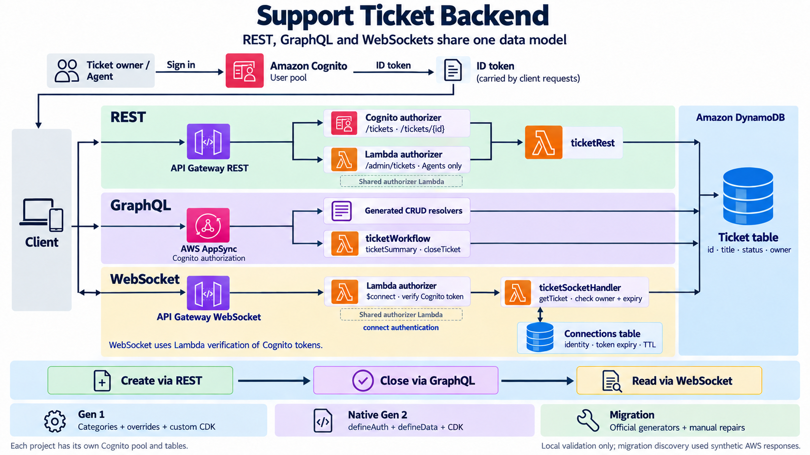

# Amplify Gen 1: support tickets



Task 1: an independently versioned local Amplify Gen 1 project covering REST, AppSync GraphQL and API Gateway WebSockets. The code and infrastructure compile locally. No AWS resources were deployed.

```bash
npm ci
npm run validate
```

Read [the implementation guide](docs/IMPLEMENTATION.md) for the steps used to build this project, and [the API contract](docs/API-CONTRACT.md) for requests and authorization behavior. [Synthesis evidence](evidence/synthesis.json) records the checks performed.

`amplify/backend/` contains native Gen 1 Auth, API and Function definitions. WebSockets are a Gen 1 custom CDK resource. `src/` is the canonical Lambda code; the prepare script copies it into self-contained Gen 1 Lambda source folders. CLI version 14.5.1 is pinned as the official source-distributed `@aws-amplify/cli-internal` package, whose binary is `amplify`. Node 22 is the target Lambda/runtime version. This session validated with Node 24.16.0.

For a future cloud deployment, configure AWS credentials, initialize an actual environment with `npm run amplify -- init`, review `npm run amplify -- status`, and then deploy with `npm run amplify -- push`. Read the guide before replacing the ignored offline metadata fixtures. Cloud deployment remains unverified.
