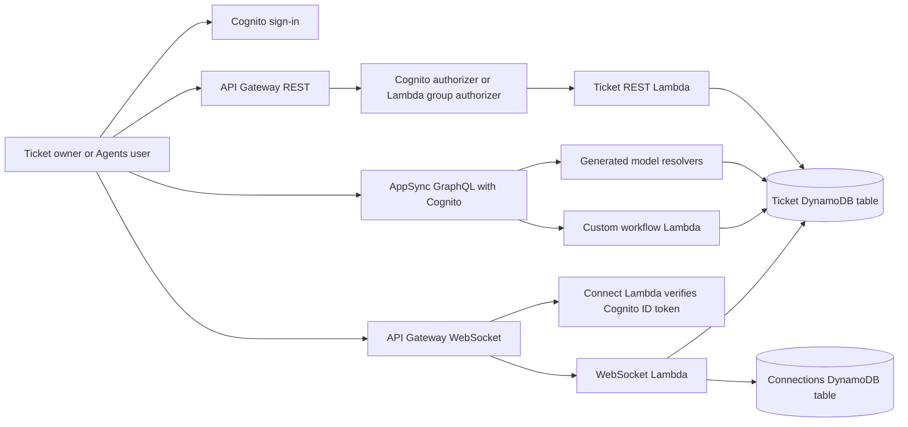

# Support-ticket API contract

Each backend uses one Cognito user pool and one shared Ticket DynamoDB table for REST, GraphQL and WebSocket ticket lookups. A second DynamoDB table stores WebSocket connections. The three projects are separate environments: they do not share tables or users unless a real migration explicitly retains/reuses the Gen 1 resources.



## REST

| Endpoint | Authorization | Behavior |
| --- | --- | --- |
| `GET /tickets` | Native Cognito user-pool authorizer | List owned tickets; Agents can list all |
| `POST /tickets` | Native Cognito user-pool authorizer | Create OPEN ticket with verified owner |
| `GET /tickets/{id}` | Native Cognito user-pool authorizer | Read owned ticket, or any ticket as an Agent |
| `PATCH /tickets/{id}` | Native Cognito user-pool authorizer | Change title/status after ownership check |
| `DELETE /tickets/{id}` | Native Cognito user-pool authorizer | Delete after ownership check |
| `GET /admin/tickets` | Custom TOKEN Lambda authorizer | Verify Cognito ID token and require `Agents` group |
| `OPTIONS` | Public preflight | Allow configured local development origin |

Send a Cognito **ID token**, not an access token, in `Authorization`. REST title validation requires 1–200 characters. Status is `OPEN`, `IN_PROGRESS` or `CLOSED`. The custom authorizer validates signature, issuer, app-client audience, expiry and `token_use`. Its policy is scoped to the requested method ARN, with caching disabled. Conditional writes protect ownership between read and update/delete. Listing uses bounded DynamoDB scans with an owner filter and a continuation token; follow `nextToken` even if a page contains zero items. For a larger application, add an owner GSI and replace scans with queries.

The DynamoDB owner value is Cognito's `sub::username`, matching the default Amplify owner claim. Agents intentionally have full model access. Generated GraphQL owner rules permit ownership reassignment; this demo keeps the standard Amplify model behavior. Add matching field-level rules in all three backends if ownership must be immutable. REST and the custom workflows do not accept owner changes.

## GraphQL

Default Amplify model resolvers implement `createTicket`, `getTicket`, `listTickets`, `updateTicket` and `deleteTicket` directly against DynamoDB. Generated subscriptions are also available, but the separate API Gateway WebSocket API is its own protocol.

Two operations use a custom Lambda resolver:

```graphql
query Summary($id: ID!) {
  ticketSummary(id: $id) { id title status summary }
}
mutation Close($id: ID!) {
  closeTicket(id: $id) { id title status owner }
}
```

The Lambda checks the AppSync identity and applies the same owner/Agents access rules as REST. Default model mutations validate GraphQL field types and required fields; they do not implement REST's title-length business rule. They require `status` in a create input, while REST initializes it to OPEN. Neither direct DynamoDB writes from REST nor Lambda `closeTicket` automatically emit model subscription events; use an AppSync mutation or an event-publishing design if that is needed.

## WebSocket

API Gateway WebSockets do not offer a native Cognito user-pool authorizer. The `$connect` REQUEST Lambda authorizer verifies an ID token from the same pool/client as REST. This is the AWS-supported Cognito-backed design, documented in [AWS WebSocket authorization](https://docs.aws.amazon.com/apigateway/latest/developerguide/apigateway-websocket-api-lambda-auth.html).

Connect with `wss://.../<stage>?token=<ID_TOKEN>`, then send:

```json
{"action":"getTicket","id":"<ticket-id>"}
```

The server responds with `{"type":"ticket","ticket":{...}}`, or `{"type":"error","message":"..."}`. This demonstrates authenticated bidirectional ticket lookup; it does not broadcast REST/GraphQL changes. Routes are `$connect`, `$disconnect`, `$default` and `getTicket`.

The connection row records verified owner, groups and JWT expiry. Every message checks the row and expiry; expired connections are removed and disconnected. DynamoDB TTL provides eventual cleanup, not immediate authorization enforcement. Disconnect deletes the row, and stale callback connections are removed. Group membership is a connection-time snapshot until expiry/reconnect. Browser WebSockets cannot set arbitrary handshake headers, hence the query parameter; do not log connection URLs or tokens.

## Local verification and future cloud smoke test

`npm run validate` performs tests and synthesis only. `sandbox` deploys real AWS resources; it is not an offline emulator. Tests use in-memory database/transport doubles plus real signed JWT verification with a locally cached JWKS. They do not prove AWS IAM, deployed authorizers, resolver execution or CloudFormation refactoring.

After an authorized future deployment, create two confirmed Cognito users and an Agent, sign in, and set environment variables for each token and endpoint. Test owner create/read/update/delete; verify REST returns 403 for another owner, GraphQL denies access through its response/errors, and WebSocket sends an error message. Verify a non-Agent is rejected by `/admin/tickets` and an Agent succeeds. Create through GraphQL and read through REST, close through the Lambda mutation and read again, then retrieve the same ticket over WebSocket. Reject invalid/expired tokens on all APIs. Inspect IAM, DynamoDB and CloudWatch results and remove trial resources afterward.

```bash
curl -H "Authorization: $ID_TOKEN" -H 'Content-Type: application/json' \
  -d '{"title":"Printer broken"}' "$REST_URL/tickets"
curl -H "Authorization: $ID_TOKEN" "$REST_URL/tickets/<id>"
curl -H "Authorization: $AGENT_ID_TOKEN" "$REST_URL/admin/tickets"
curl -H "Authorization: $ID_TOKEN" -H 'Content-Type: application/json' \
  -d '{"query":"query { listTickets { items { id title status } } }"}' "$GRAPHQL_URL"
```

Use an installed WebSocket client, for example `wscat`, to connect with the token query parameter. Keep token acquisition and test users outside Git.
