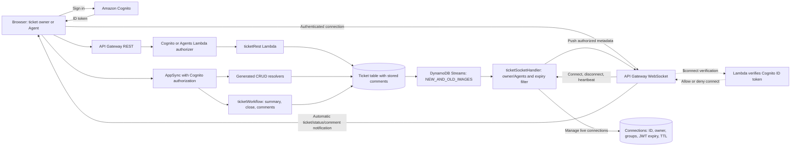

# Support-ticket API contract

This is the current contract for the deployed live-notification version, verified
on 7 October 2026. Each project has its own Cognito pool, Ticket table, and
Connections table. REST and GraphQL share that project's Ticket table, including
its protected comment attribute. DynamoDB Streams sends changes to the existing
WebSocket Lambda, which pushes metadata to authorized connected browsers.

## Architecture


[Two-browser sequence and diagram sources](CURRENT-DIAGRAMS.md).



## REST

| Endpoint | Authorization | Behavior |
| --- | --- | --- |
| `GET /tickets` | Cognito user-pool authorizer | Strongly consistent, paginated scan of the signed-in user's tickets, including for Agents |
| `POST /tickets` | Cognito user-pool authorizer | Create OPEN ticket with verified owner |
| `GET /tickets/{id}` | Cognito user-pool authorizer | Read owned ticket, or any ticket as an Agent |
| `PATCH /tickets/{id}` | Cognito user-pool authorizer | Update title/status after an ownership check |
| `DELETE /tickets/{id}` | Cognito user-pool authorizer | Delete the ticket and its embedded comments after an ownership check |
| `GET /tickets/{id}/comments` | Cognito user-pool authorizer | Return `{"items":[...]}` after a ticket access check |
| `POST /tickets/{id}/comments` | Cognito user-pool authorizer | Append `{"body":"Comment text"}`; return the new comment with HTTP 201 |
| `GET /admin/tickets` | Custom TOKEN Lambda authorizer | Require Agents membership; return only tickets owned by current Agents group members |
| `OPTIONS` | Public preflight | Allow the configured localhost and hosted-site origins |

Send the Cognito **ID token** in `Authorization`. REST titles contain 1–200
characters. Status values are `OPEN`, `IN_PROGRESS`, and `CLOSED`. The custom
authorizer validates signature, issuer, app-client audience, expiry, and
`token_use`; its exact-method ARN policy has caching disabled. Conditional
writes protect ownership. Follow `nextToken` even when a scan page is empty.

The stored owner uses `sub::username`. Generated GraphQL owner fields return
the username portion; list filters use the stored composite value. Agents have
full model access. Generated GraphQL owner rules permit ownership reassignment;
REST and custom workflows
do not accept owner changes. The old owner receives only a ticket-removal
notification when access changes.

The website's **My tickets** view uses the signed-in owner filter for both REST
and generated GraphQL listing, even for Agents. **Agent queue** uses the custom
REST endpoint and includes tickets from all current Agents members, excluding
customer tickets. Cognito group membership is read in pages on each Agent queue
request; existing REST and GraphQL tickets need no backfill. Queue membership
follows the ticket's stored owner and current Cognito group membership.
The Agent response includes the permitted `agentOwners` so live events can be
filtered without losing loaded pages. Refresh and reconnect refresh that
membership snapshot. Pagination and live updates retain the selected queue.
Agents still have permission to read and manage customer tickets by ID.

## GraphQL

Generated resolvers implement `createTicket`, `getTicket`, `listTickets`,
`updateTicket`, and `deleteTicket` directly against DynamoDB. Four operations
use the existing workflow Lambda, which checks the verified AppSync identity
and enforces owner/Agents access:

```graphql
query Summary($id: ID!) {
  ticketSummary(id: $id) { id title status summary }
}
mutation Close($id: ID!) {
  closeTicket(id: $id) { id title status owner }
}
query Comments($id: ID!) {
  listTicketComments(id: $id) { id body authorId author createdAt }
}
mutation AddComment($id: ID!, $body: String!) {
  addTicketComment(id: $id, body: $body) {
    id body authorId author createdAt
  }
}
```

Comments contain a server-generated ID and timestamp, verified author ID and
email/username, and trimmed body. Submitted author fields are ignored. The
server accepts at most 2000 UTF-8 bytes per comment and 100 comments per ticket.
DynamoDB atomically appends comments with ownership and size conditions; this
avoids overwriting another concurrent append. The stored comment attribute is
not a generated Ticket input field, so comments use the protected operations.

Generated model mutations validate GraphQL types and required fields, but do
not implement REST's title-length rule. They require status when creating a
ticket; REST initializes OPEN. Generated AppSync subscriptions are a separate
protocol: the website's API Gateway notifications come from DynamoDB Streams
and therefore include REST, generated GraphQL, and workflow Lambda writes.

The generated GraphQL create pipeline includes a `preAuth` slot that sets
`owner` from verified Cognito claims for every creator, including Agents.
Submitted create-owner values are ignored, matching REST creation. This avoids
ownerless Agent tickets when group authorization bypasses the generated owner
default. Existing update authorization remains unchanged.

## WebSocket notifications

The `$connect` REQUEST Lambda authorizer verifies a Cognito ID token from this
project's pool and client. Connect to `wss://.../<stage>?token=<ID_TOKEN>`.
Keep tokens and token-bearing connection URLs out of logs and Git.

After connection, no lookup or subscribe request is needed. A new ticket,
title/status change, or comment append generates a push such as:

```json
{
  "type": "ticketChanged",
  "eventId": "<stream-event-id>",
  "change": "updated",
  "ticket": {
    "id": "<ticket-id>",
    "title": "Printer broken",
    "status": "IN_PROGRESS",
    "owner": "<sub>::<username>",
    "createdAt": "2026-10-07T08:00:00.000Z",
    "updatedAt": "2026-10-07T08:01:00.000Z"
  },
  "commentsChanged": false
}
```

`change` is `created`, `updated`, or `commentAdded`. Comment append events
set `commentsChanged: true` and send metadata; the selected browser then loads
comments from the protected REST endpoint. Comment bodies are not broadcast.

Deletion or access revocation sends:
```json
{"type":"ticketRemoved","eventId":"<stream-event-id>","ticketId":"<ticket-id>"}
```

Recipients must be the ticket owner or an Agents member. Connection records
store the verified owner, groups, JWT expiry, and server-derived callback
endpoint. The broadcaster scans connections in pages, skips/removes expired
sessions, and removes gone connections. Disconnect deletes its row. TTL is
eventual cleanup, not the authorization check. Groups remain a connection-time
snapshot until expiry/reconnect.

The browser connects automatically after sign-in. Pause/Resume controls live
delivery; reconnect resyncs through the strongly consistent REST list endpoint
and reloads selected comments. A four-minute `{"action":"ping"}` heartbeat
receives `{"type":"pong"}` through the default route. Event IDs suppress
duplicate delivery; stale ticket versions do not replace newer UI data, and
incoming updates preserve unsaved form edits. Stream retries are bounded to
three attempts and one hour of record age. Refresh/reconnect recovers current
database state; missed notification history is not replayed.

Routes remain `$connect`, `$disconnect`, `$default`, and `getTicket`. The
legacy `{"action":"getTicket","id":"..."}` request still returns
`{"type":"ticket","ticket":{...}}` or `{"type":"error","message":"..."}`.
It is retained for compatibility and API tests; the website uses push updates.

These are in-page notifications while the signed-in application is open.
Operating-system notification permissions or popups are not configured.

## Verification

`npm run validate` runs TypeScript checks, 37 local runtime/UI tests, and
infrastructure synthesis. It performs no deployment. A sandbox command creates
real AWS resources.

The deployed version passed 17 live API check groups, five hosting checks, and
12 checks using two real browser sessions in each project. Live CI covers
verified authors, REST/GraphQL comment persistence, generated GraphQL writes
preserving comments, push delivery to owners/Agents, and cross-owner denial.
Browser checks cover automatic creation/status/comment updates without refresh,
draft preservation, pause/resume recovery, and sign-out. Exact new fixtures and
temporary CI identities were cleaned up; pre-existing tickets were preserved.

- [Feature behavior and implementation](LIVE-UPDATES-AND-COMMENTS.md)
- [Latest CI evidence](../evidence/live-feature-ci.json)
- [Two-session browser checks and cleanup](../evidence/live-feature-browser.json)
- [Cloud deployment history and endpoints](CLOUD-DEPLOYMENT.md)
