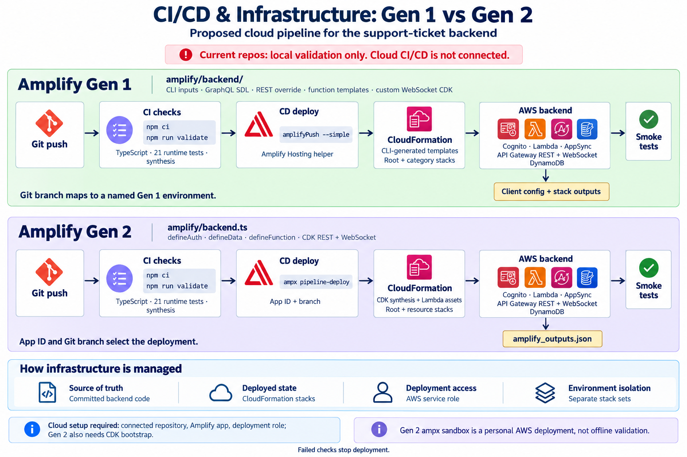
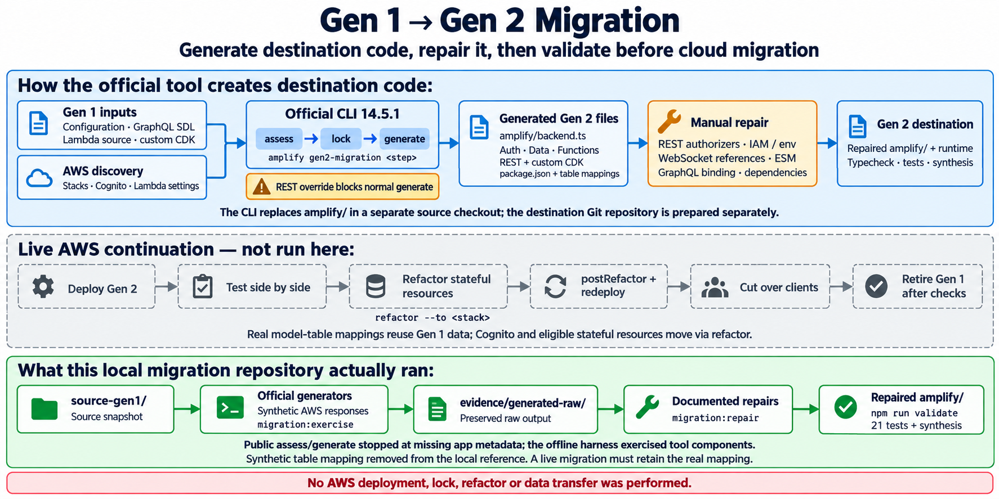

# CI/CD, infrastructure and migration diagrams

## Gen 1 and Gen 2 CI/CD

The repositories currently contain local validation commands, not a connected cloud pipeline. The diagram shows a proposed deployment path. Gen 1 uses category inputs, SDL, function templates, a REST override and custom CDK. Native Gen 2 uses TypeScript factories and CDK. Both projects already provide `npm run validate`; their scripts perform TypeScript checks, 21 runtime tests and synthesis.

The cloud command examples follow AWS documentation: [Gen 1 Hosting deployment helper](https://docs.aws.amazon.com/amplify/latest/userguide/edit-build-settings.html) and [Gen 2 pipeline deployment](https://docs.amplify.aws/react/deploy-and-host/fullstack-branching/cross-account-deployments/). No CI service, build specification, service role or deployed environment was created by this diagram task.

Before using this design, establish actual deployment metadata. Gen 1's ignored offline fixtures must be replaced with real initialized/pulled metadata; they must not become the deployment environment. Use the project's implementation guide for the preparation steps.

## Migration tool and destination project

The blue band explains code generation and manual repairs. The green band shows the actual local harness: source snapshot, official components with synthetic discovery responses, preserved raw output, repairs and validation. The destination repository was prepared separately; the tool does not create that Git repository automatically.

The dashed band depicts future cloud work described in the [official migration guide](https://docs.amplify.aws/react/start/migrate-to-gen2/migrate-existing-app/). It has not been executed. The local repaired reference uses fresh-resource wiring and omits the synthetic table mapping; it cannot demonstrate preservation of deployed users or data.

Both images were generated with built-in imagegen. [Complete generation prompts and saved locations](pipeline-migration-diagram-prompts.md) are retained. See the migration repository's implementation guide and report for the exact findings and repair diff.
