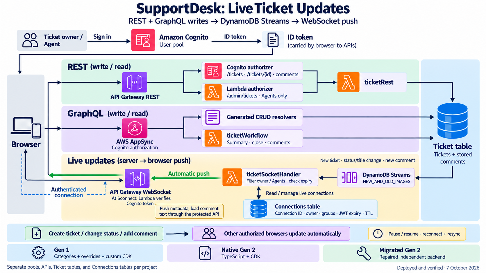
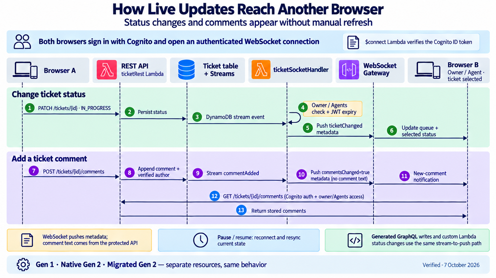

# CI/CD, infrastructure and migration diagrams

## Current runtime notification architecture

These current images supersede the original lookup illustration for runtime
behavior. See [diagram details and editable sources](CURRENT-DIAGRAMS.md).
The CI/CD diagram below reflects the current GitHub Actions workflows, reviewed
on 8 October 2026. The migration-tool picture remains a historical local exercise.

## Current CI/CD across all three projects

Updated on **8 October 2026** against each repository's committed workflow,
deployment scripts, hosting template, GitHub variables, and latest successful
deployment run. The same comparison diagram is included in all three projects.
Each repository runs its own pipeline in `ap-south-1`, with its own Amplify app,
OIDC role, backend stacks, identity/data resources, and frontend hosting stack.

1. A push to `main` or manual dispatch starts GitHub Actions on Ubuntu, with
   Node 22 and npm 11.13.0. `npm ci` installs locked dependencies;
   `npm run validate` runs type checks, runtime/UI tests, and local synthesis.
2. GitHub OIDC supplies temporary AWS credentials. Gen 1 configures and scans
   CLI plugins. `node scripts/hosting.cjs prepare` deploys the CloudFormation
   hosting stack before the backend deployment.
3. The backend stage follows the matching row below and exports actual deployed
   endpoints and Cognito IDs to `amplify_outputs.json`.
4. Gen 1 checks deployed Lambda packages. All projects run
   `node scripts/smoke-test.cjs` against REST, GraphQL, and WebSocket APIs,
   including authorization, comments, and stream-driven live notifications.
5. `npm run frontend:build` builds with this deployment's outputs, then
   `node scripts/hosting.cjs publish` uploads the frontend to its private S3
   asset bucket. CloudFront serves HTTPS using Origin Access Control (OAC).
   A second S3 website bucket redirects visitors to that HTTPS site.
6. `node scripts/check-hosting.cjs` verifies hosted asset hashes, the build
   manifest, the S3 redirect, and denied anonymous access to the S3 origin.

| Project | Backend source and deployment | Output export |
| --- | --- | --- |
| Amplify Gen 1 | `amplify/backend/`; `node scripts/deploy.cjs` initializes the existing `dev` environment and runs `amplify push --yes` | Deployment script writes `amplify_outputs.json` |
| Native Gen 2 | `amplify/backend.ts`; `ampx pipeline-deploy --debug --branch main --app-id "$AMPLIFY_APP_ID"` | `ampx generate outputs --branch main --app-id "$AMPLIFY_APP_ID"` |
| Migrated Gen 2 | Repaired Gen 2 source; the same Gen 2 commands with its own app ID and independent stacks | The same Gen 2 output command, for its own app |

Failed steps stop later deployment and publishing. The artifact step uses
`if: always()` to attempt upload of available outputs, synthesis, API results,
and hosting evidence as `deployment-evidence`, retained for 14 days. Deployments
are serialized per repository. The two-session browser checks are separate
verification; they are not a stage in this workflow.

The pipelines deploy Cognito, API Gateway REST/WebSocket, AppSync, Lambda, and
DynamoDB resources. Each project's Ticket stream invokes its socket Lambda for
authorized automatic notifications; its Connections table stores sessions.
Frontend hosting uses the dedicated S3/CloudFront stack. The migrated project
remains an independent deployment; this pipeline does not transfer Gen 1 users
or data.

[Workflow](../.github/workflows/deploy.yml) · [Deployment details](CLOUD-DEPLOYMENT.md) ·
[Editable diagram](ci-cd-infrastructure-gen1-gen2.mmd) ·
[Generation prompt, source hashes, and verified runs](ci-cd-diagram-generation.json)

## Migration tool and destination project

The blue band explains code generation and manual repairs. The green band shows the actual local harness: source snapshot, official components with synthetic discovery responses, preserved raw output, repairs and validation. The destination repository was prepared separately; the tool does not create that Git repository automatically.

The dashed band depicts future stateful migration work described in the [official migration guide](https://docs.amplify.aws/react/start/migrate-to-gen2/migrate-existing-app/). It has not been executed. The local repaired reference uses fresh-resource wiring and omits the synthetic table mapping; it cannot demonstrate preservation of deployed users or data.

Both images were generated with built-in imagegen. [Current and historical generation records](pipeline-migration-diagram-prompts.md) are retained. See the migration repository's implementation guide and report for the exact findings and repair diff.
