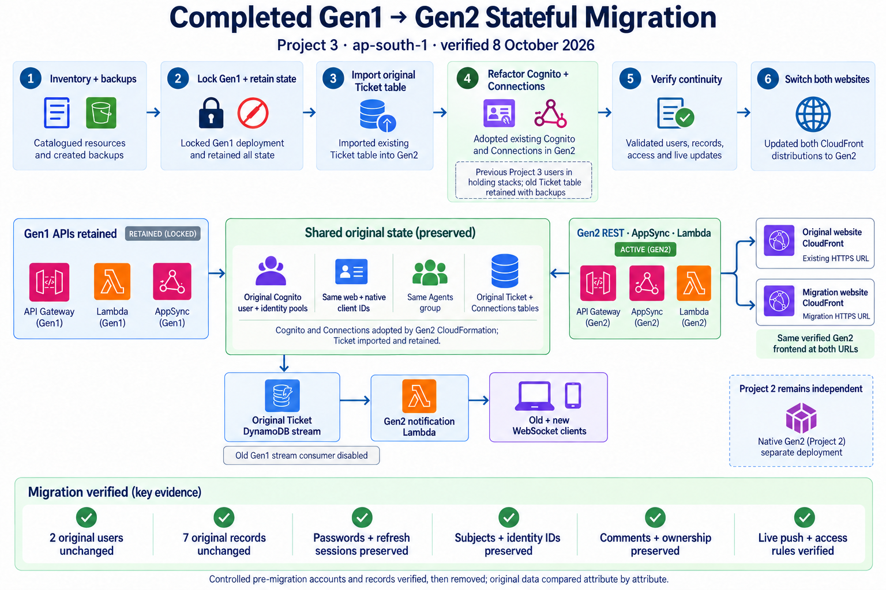

# Current CI/CD and migration architecture — 8 October 2026

The completed migration changes the relationship between the projects. Gen1 and Project3 share the original stateful resources. Native Gen2 remains independent.

| Project | Current workflow | Runtime state |
| --- | --- | --- |
| Project1: Gen1 reference | Node22/npm11.13, `npm ci`, `npm run validate`, always-upload validation evidence; backend deployment locked | Original APIs retained; original users/data adopted or imported by Project3 |
| Project2: native Gen2 | Validate → AWS OIDC → prepare hosting → `ampx pipeline-deploy` → generate outputs → live API checks → build/publish frontend → hosting checks | Independent Cognito pools and DynamoDB tables |
| Project3: migrated Gen2 | Same Gen2 deployment stages, plus main-branch import synthesis checks and publication to both website URLs | Original Gen1 Cognito pools/clients, Agents group, Ticket and Connections tables |

Push to `main` or manual dispatch starts each repository's workflow. Failed checks stop subsequent deployment/publication. Available evidence is uploaded with `if: always()` and retained for 14 days. Gen2 deployments are serialized per repository. Browser migration checks were performed separately and are recorded in Project3's evidence.

Project3 retains original pool/client names and configuration after the CloudFormation refactor. Its model maps the main branch to the original Gen1 Ticket table. Both tables are protected and retained. Gen1 deployment is frozen; Project3 is the source for future backend and client changes.

The original Ticket stream now invokes one Gen2 notification Lambda. It filters by owner/Agents and session expiry, and posts to both old and new WebSocket endpoints. The old Gen1 stream consumer is disabled. Retained Gen1 REST/GraphQL/WebSocket APIs remain available for existing open clients.

Project3 publishes one verified frontend build to its CloudFront site and the original Gen1 CloudFront site. Both use the preserved Cognito web client and the Gen2 API endpoints. Existing hashed assets remain available to open tabs. The original hosting bucket has narrowly scoped publish permissions for Project3's CI role.

The live migration preserved 2 original users and all 7 original Ticket records exactly, and verified passwords, refresh sessions, subjects, client/identity IDs, comments, ownership, access rules and live notifications. Previous Project3 state remains recoverable in holding stacks and its retained old Ticket table.

The authoritative migration report and sanitized evidence are in [Project3's stateful migration report](https://github.com/gowthammail4macair/amplify-gen1-to-gen2-migration/blob/main/docs/STATEFUL-MIGRATION.md). The original local migration-tool illustration is historical. The current diagrams were generated using the built-in imagegen tool and inspected for native-project isolation and preserved-state ownership.

[Editable CI/CD flow](ci-cd-infrastructure-gen1-gen2.mmd) · [Generation record](ci-cd-diagram-generation.json)
