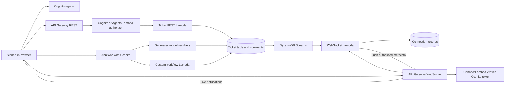

# Live notifications and ticket comments

## Current event flow

After Cognito sign-in the browser opens an authenticated WebSocket connection.
The Live channel card shows connection state, recent notifications, and a
Pause/Resume control. No manual ticket lookup is required. New tickets and
status/title changes update the queue and counters. The selected ticket's status
and comments update automatically; unsaved form edits stay in place.

Select a ticket to reveal its status editor and Comments section. Choose Open,
In progress, or Closed and click Save changes. Enter a comment and click Add
comment. Comments show the verified author and timestamp and persist across
reloads. Refresh comments is also available.

REST comment routes are GET/POST /tickets/{id}/comments. AppSync also exposes
listTicketComments(id) and addTicketComment(id, body) through the existing custom
Lambda resolver. Both authorize the ticket owner or an Agents member. Author
fields come from verified Cognito claims, not submitted data. DynamoDB appends
comments atomically to the ticket with ownership and size conditions. Comment
storage is bounded to 100 comments per ticket and 2000 UTF-8 bytes per comment.
The generated GraphQL Ticket model does not expose the stored comment attribute
as a writable input; clients use the protected custom operations.

The existing Ticket table's NEW_AND_OLD_IMAGES stream invokes the existing
WebSocket handler. It pushes only ticket metadata to authorized owner/Agent
connections. Comment events prompt the selected browser to read the protected
comment endpoint. Expired and gone connections are removed. Deletion or access
revocation removes a ticket from the browser queue. The old getTicket WebSocket
route remains available for API compatibility but is no longer used by the UI.

Browser connections reconnect with a current Cognito token and resync the queue.
A heartbeat keeps idle connections active. Event IDs suppress duplicate delivery
and older ticket versions are ignored. Stream retries are bounded to three
attempts and one hour of record age; the persisted database remains the source
of truth. Refresh/reconnect recovers current state when a live notification is
missed. This demo scans connection records in pages; larger deployments should
index connections by owner and use a separate comment table for longer threads.

The Gen 1 custom CDK stack imports the transformer-generated Ticket stream ARN
and attaches a scoped read policy and event source mapping. Both Gen 2 versions
wire the model table stream with CDK. The migrated project keeps the repaired
independent environment; these additions do not perform a stateful migration.
No existing pool, Ticket table, or hosting resource is replaced.

Validation includes local runtime/UI tests and synthesis, plus live CI checks for
REST/GraphQL comments, REST and generated GraphQL push events, custom Lambda
status-change events, owner/Agents delivery, and cross-owner isolation. CI test
identities and fixtures are removed in the existing finally cleanup.

AWS references: [Gen 1 model Lambda triggers](https://docs.amplify.aws/gen1/react/tools/cli/usage/lambda-triggers/),
[Gen 2 DynamoDB Streams](https://docs.amplify.aws/javascript/build-a-backend/functions/examples/dynamo-db-stream/).

## Deployment verification — 7 October 2026

The deployed version passed 30 local/runtime UI tests, 17 live AWS API check
groups, five hosting checks, and 12 checks using two real browser sessions.
The observer received REST and GraphQL creations, REST status updates, a custom
Lambda close, and a new comment without refresh. Pause/resume recovered a missed
status update and retained the persisted comment. Incoming updates preserved an
unsaved title. Both sessions signed out.

See [CI results](../evidence/live-feature-ci.json),
[browser results and fixture cleanup](../evidence/live-feature-browser.json), and
[the browser screenshot](../evidence/live-feature-browser.jpg). The screenshot
was captured before the new fixtures were removed. Pre-existing tickets and the
existing demo owner account were preserved. Browser tests used the same owner in
two sessions; cross-owner and Agents authorization were tested in live CI.
